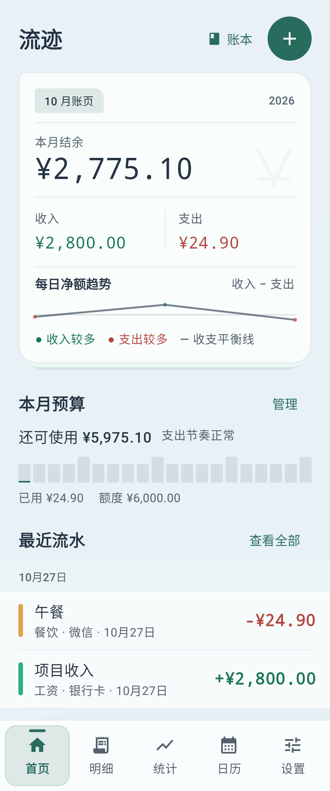
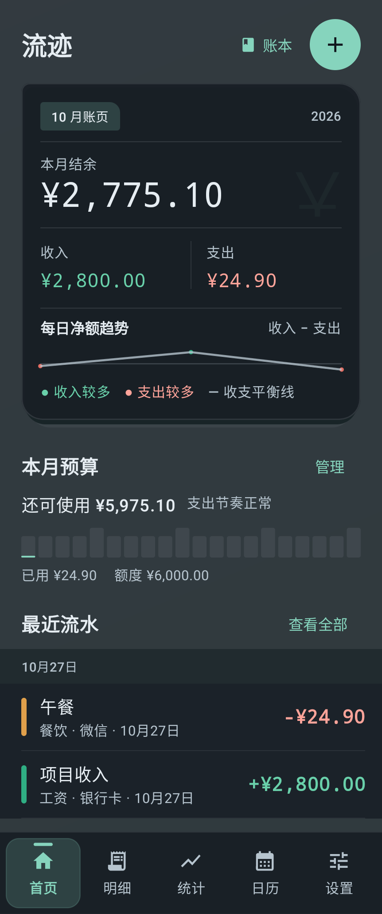
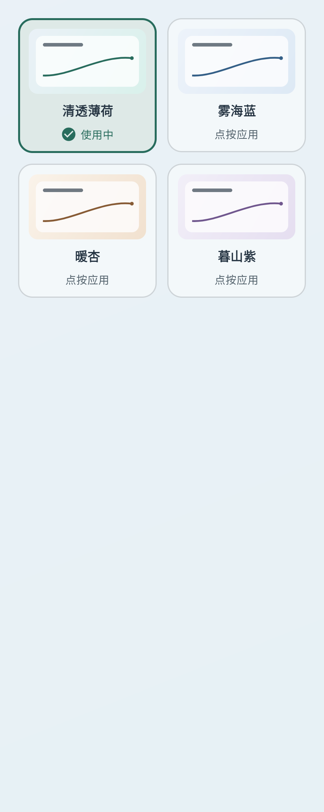
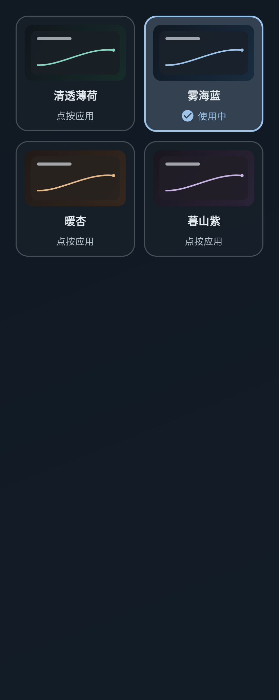

# 流迹 · 离线安卓记账

用分类、账本和收支方式整理每一笔收入与支出，按统计图和日历回看记录。原生 Android 应用，默认中文、人民币，无账号、无广告、无云同步。

[下载 1.1.18 APK](https://github.com/ggbo13/liuji-ledger/releases/download/v1.1.18/liuji-v1.1.18.apk) · [SHA-256 校验文件](https://github.com/ggbo13/liuji-ledger/releases/download/v1.1.18/liuji-v1.1.18.apk.sha256) · [版本说明](https://github.com/ggbo13/liuji-ledger/releases/tag/v1.1.18) · [安装与测试说明](docs/RELEASE_NOTES_1.1.18.md)

最低支持 **Android 8.0**。已有用户请先导出完整备份，再覆盖安装；不要先卸载旧版。

## 功能

- 新增、编辑、搜索及筛选收支；明细按日期分组，左滑露出删除按钮，确认后删除并可短时撤销。
- 分类支持七色标识、收入/支出独立拖动排序、停用及重新启用；记账时多行显示并遵循手动顺序。
- 用日常、工作或项目等“账本”区分记录范围；现金、微信、支付宝、银行卡等作为“收支方式”。
- 周、月、年收支双折线图，按住并左右拖动查看日期、收入与支出，分类可点开明细。
- 七列月历显示每日收支，选中日期后查看、编辑流水。
- 总预算、分类预算、周期账单及本地通知提醒。
- 四套离线官方主题：清透薄荷、雾海蓝、暖杏、暮山紫；每套支持跟随系统、白天和黑夜模式，自定义图片与遮罩仍保留。
- 页面方向过渡、主题换色和折叠动效，可在外观设置关闭，并遵循系统动画设置。
- 可选系统生物识别或锁屏凭据验证；ZIP 完整备份与旧 JSON 恢复、筛选后导出 UTF-8 BOM CSV。

1.1.18 更新：A+「活页账本」原生界面、月份账页、收支分栏、20格预算刻度、顶部快速记账与滑动书签导航；新图标采用「账页与书签」。页面过渡为28dp/260ms，底栏书签220ms，可关闭动效；草稿、系统返回、图表手势与原有数据关联继续保留。修正同日切换时区后的近期账单刷新及RTL书签位置。

1.1.17 加入的四套官方主题、恢复上次图片、完整明暗语义配色、页面状态隔离、图表路径缓存和日历长流水懒加载继续保留。选择主题会应用配套渐变，但不改变当前显示模式或遮罩；原图片仅在本机保留，不额外打包进未使用图片的备份。

1.1.16 加入的带背景图片与外观 ZIP 完整备份、恢复前预览、独立保护备份和应用内备份提醒继续保留；旧 JSON v1—v3 仍可恢复。备份未经加密，包含个人记录与图片，请自行妥善保管。应用锁和系统权限不随备份迁移。

不包含银行/SMS 自动导入、登录、多人共享或账户间转账入口。早期资产账户与转账兼容代码仍保留，但不作为当前产品功能入口。

## 数据与隐私

收支等业务数据保存在本机 Room 数据库，金额使用整数分；外观偏好及草稿保存在本机偏好设置。数据库及 JSON 备份版本为 3，保留旧备份兼容路径。

应用没有联网权限。图片、备份和导出文件由系统选择器处理；你选择的文件提供方可能有自己的联网行为。本仓库不含个人账本、私有背景图片或发布签名密钥。

下面均为安卓模拟器运行截图，使用合成夹具，不包含个人账目或私人图片。测试中的记录不是随应用预装的账目。

<details>
<summary>查看 1.1.18 活页账本与新图标</summary>

  

</details>

<details>
<summary>查看白天／黑夜官方主题预览</summary>

 

</details>

## 技术结构

Kotlin、Jetpack Compose、Material 3、Room、AndroidX Biometric；单 Activity，ViewModel 管理界面与提交状态，Room 事务保护关联数据和备份恢复。

```text
app/src/main/java/com/liujii/ledger/
├── data/           # 数据模型、数据库、备份、汇总与校验
├── ui/             # 记账、明细、统计、日历与设置
├── reminder/       # 本地提醒与重启恢复
├── LedgerViewModel.kt
└── MainActivity.kt
app/src/test/       # JVM 单元测试
app/src/androidTest/# 内存数据库与 Compose 仪器测试
gradle/wrapper/     # 固定 Gradle 版本与下载校验值
docs/              # 版本、验证与安装说明
```

## 本地构建

准备 JDK 21（已验证版本）、Android SDK Platform 36 与 Build Tools 36.0.0。可用 Android Studio 打开项目，或配置 `JAVA_HOME`、`ANDROID_HOME` 后使用命令行。也可在未提交的 `local.properties` 中配置 `sdk.dir`。

首次构建需要联网下载 Gradle、Android SDK 和 Maven 依赖；依赖缓存齐全后可使用 `--offline`。请将仓库克隆到英文路径，避免部分 Windows 工具处理中文路径时出错。

```bash
git clone https://github.com/ggbo13/liuji-ledger.git
cd liuji-ledger
git switch --detach v1.1.18

# macOS / Linux
./gradlew :app:assembleDebug
./gradlew :app:testDebugUnitTest :app:lintDebug
./gradlew :app:assembleDebugAndroidTest
```

Windows PowerShell 使用：

```powershell
.\gradlew.bat :app:assembleDebug
.\gradlew.bat :app:testDebugUnitTest :app:lintDebug
.\gradlew.bat :app:assembleDebugAndroidTest
```

Debug APK 位于 `app/build/outputs/apk/debug/app-debug.apk`。Debug 默认签名与正式发布包不同，不能直接覆盖正式版；不要为安装 Debug 包而卸载日常使用的正式版。

1.1.18 对应源码以 `v1.1.18` 标签为准，开发改动见 [PR #3](https://github.com/ggbo13/liuji-ledger/pull/3)，依赖1.1.17的 [PR #2](https://github.com/ggbo13/liuji-ledger/pull/2)。PR 不自动合并，默认分支的发布文档更新不等于已合并应用源码。

在独立测试设备或模拟器上运行仪器测试：

```bash
./gradlew :app:connectedDebugAndroidTest
```

### Release 签名

发布密钥不会上传。需要自行构建签名 Release 时，在本机用户级 `gradle.properties` 或安全的环境变量中设置下列 Gradle 属性：

- `LIUJI_STORE_FILE`：你自己的密钥库路径。
- `LIUJI_KEY_ALIAS`：密钥别名。
- `LIUJI_STORE_PASSWORD`：密钥库密码。
- `LIUJI_KEY_PASSWORD`：密钥密码。

然后运行 `./gradlew :app:assembleRelease`；Windows 使用 `.\gradlew.bat :app:assembleRelease`。自有签名生成的包不能覆盖本项目 Releases 中使用原签名的安装包。不要把密码写入仓库或提交历史。

## 验证状态

1.1.18 于2026-10-27完成Debug／原签名Release构建；两种变体各114项单元测试通过，API30、API36各203项数据库及界面测试通过，均为0失败、0错误、0跳过。包含真实软键盘的程序聚焦与触摸聚焦、首页12组小屏／大字／明暗布局，以及48组官方主题选择器矩阵。远端两种变体Lint均为0错误、21条警告，本地为0错误、8条警告。

结果见[1.1.18最终检查](https://github.com/ggbo13/liuji-ledger/actions/runs/40469618847)及[安装与测试说明](docs/RELEASE_NOTES_1.1.18.md)。同机一万笔合成数据的模拟器性能记录没有证明整体帧耗时改善，图表拖动和切页仍需实体设备复核；不承诺真机帧率。真机覆盖安装、厂商输入法、桌面裁切、边缘返回和系统权限场景未执行。

以下保留1.1.17历史验证记录：

1.1.17 于 2026-10-23 完成 Debug／原签名Release构建；两种变体各114项单元测试通过，API30、API36各183项仪器测试通过，均为0失败、0错误、0跳过。每个系统保存48张主题选择器矩阵截图及36张原有视觉回归截图。远端两种变体Lint均为0错误、21条警告，本地为0错误、8条警告，差异主要来自联网依赖版本检查。

结果见[完整检查报告](https://github.com/ggbo13/liuji-ledger/actions/runs/39835041148)及[安装与测试说明](docs/RELEASE_NOTES_1.1.17.md)，包含同机一万笔合成账目的性能原始记录，不承诺真机固定帧率。模拟器通过不代表所有手机场景都已验证：真机覆盖安装、系统边缘返回、应用锁、通知重启、超大图片及厂商输入法仍需验证；键盘输入的测试语义注入不等于人工敲击所有输入法。

## 设计、依赖与许可

视觉采用冷灰蓝、薄荷绿、珊瑚红与清透背景，界面布局为独立实现。功能设计参考过成熟记账产品的一般工作流，与相关产品没有隶属关系。

本项目使用 AndroidX、Jetpack Compose、Material 3、Room、Kotlin 和 kotlinx.coroutines 等依赖；它们的许可与版权声明分别适用。Gradle Wrapper 为 Gradle 官方生成文件，保留原有许可声明。

本项目自有代码采用 [MIT 许可证](LICENSE)，版权署名为 `2026 ggbo13`。允许修改、分发和商用，但须保留版权及许可声明。第三方依赖和 Gradle Wrapper 适用各自许可；用户账目、私人图片及签名密钥不属于公开源码，也不因本许可证而公开。

GitHub Actions 自动执行构建、两种变体单元测试与 Lint，并分别在 API30、API36 模拟器运行仪器测试。具体是否通过、失败或跳过，以对应工作流报告为准。CI 不含正式签名凭据，不自动发布安装包；报告只保留7天。
